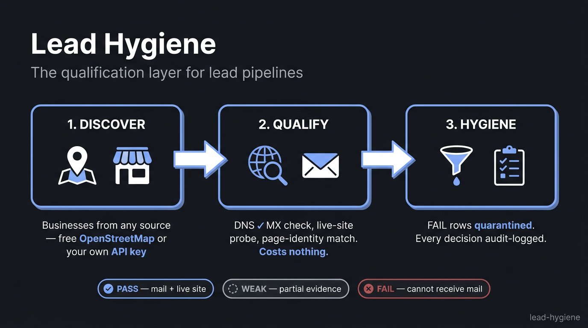

# Lead Hygiene



**Lead Hygiene is the qualification layer for lead generation pipelines.** It
takes raw business leads from any source and grades every row on hard evidence —
DNS, HTTP and page identity — so your outreach list contains businesses that
actually exist, actually operate, and actually receive mail.

Scrapers are a solved problem. What separates a working pipeline from a wasted
one is what happens after the scrape: dead domains, parked pages, social-media
placeholders pretending to be websites, and unverified emails. Lead Hygiene
removes those before they reach your CRM.

```
Discover  ->  Qualify  ->  Hygiene
(free or     (MX, site,     (quarantine,
 your key)    identity)      audit log)
```

## What it checks

| Verdict | Evidence |
|---|---|
| **PASS** | Real MX record + live site answered + page identity consistent with the company name |
| **WEAK** | Partial evidence or contradictions: DNS unresolvable, dead site, social-page "website", title mismatch |
| **FAIL** | Domain cannot receive mail (or does not exist) |

Every row carries its evidence columns: `mx_ok`, `site_live`, `http_status`,
`site_title`, `redirect_host`, `title_match`, plus a `qualify_flags` list
(`catch_all`, `no_linkedin`, `dns_error`, …). A catch-all domain accepts any
address, so a `CATCH_ALL` email is reported as such — never as verified.

## Install

```bash
pip install -e .
```

## Quick start

```bash
# 1. Discover (free, no key required — OpenStreetMap)
lead-hygiene discover --query "coffee shop in Bristol" --out leads.csv

# 2. Qualify ($0: DNS + plain HTTP)
lead-hygiene qualify leads.csv --out qualified.csv

# 3. Quarantine FAIL rows, keep an audit log
lead-hygiene hygiene qualified.csv
```

## Providers

| Provider | Cost | Notes |
|---|---|---|
| `osm` (default) | free | OpenStreetMap via Overpass. No key. Coverage varies by region |
| `google_places` | ~$ per call | Your own Google Places API key (`GOOGLE_PLACES_API_KEY`) |

Keys go in your environment — nothing is hardcoded and no key is required for
the free path.

## Compliance notes

- Respect [Nominatim's usage policy](https://operations.osmfoundation.org/policies/nominatim/)
  and Overpass fair-use: cache results, keep request rates low, attribute
  OpenStreetMap contributors (ODbL).
- Google Places has its own storage and caching terms — check them before
  storing results.
- Lead data is personal data in most jurisdictions. If you outreach, you own
  the compliance (GDPR, CAN-SPAM, PECR).
- This is a local CLI. Don't wrap it in a public web service without adding
  input validation first — the site probe follows redirects.

## License

MIT
